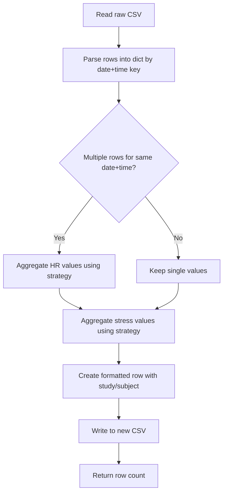

# formatCSV Function - Feasibility Assessment & Implementation Plan

## Executive Summary

**Feasibility: FEASIBLE with IMPORTANT CAVEATS**

The requested `formatCSV` function can be implemented, but requires critical design decisions about data aggregation that could impact data integrity.

---

## Current State Analysis

### Current CSV Output Structure (From Exampleoutput.png)
```
MMDDYY,Hour:Minute,Message_Type,Heart_Rate,Stress_Level,Source_File
```

**Actual current output:**
```csv
22525,15:28,monitoring,,75,bahrant3@gmail.com_314744734613.fit
22525,15:29,monitoring,,73,bahrant3@gmail.com_314744734613.fit
22625,06:25,stress_level,,-2,bahrant3@gmail.com_314744734613.fit
22625,06:30,stress_level,,13,bahrant3@gmail.com_314744734613.fit
```

**Note:** Date format appears to be DDMYY (not MMDDYY) - e.g., 22525 = May 25, 2022

**Key characteristics:**
- ✅ Already uses 24-hour time format (`%H:%M` on line 177)
- Multiple rows can have identical date/time combinations
- `Message_Type` distinguishes source: `record`, `monitoring`, `stress_level`
- `Source_File` contains FIT filename (NOT email address)

---

## Requirements Analysis

### Requirement 1: Remove "Personal Email Column"
**✅ CONFIRMED from screenshot**

The `Source_File` column contains email addresses embedded in filenames:
- Example: `bahrant3@gmail.com_314744734613.fit`

**Action:** Remove entire `Source_File` column during formatting.

Current columns:
- `MMDDYY` - Date (appears to be DDMYY based on screenshot)
- `Hour:Minute` - Time (already in 24-hour format ✓)
- `Message_Type` - Data source type (`monitoring`, `stress_level`)
- `Heart_Rate` - HR value (empty when Message_Type is stress_level)
- `Stress_Level` - Stress value (empty when Message_Type is monitoring)
- `Source_File` - FIT filename with email **← REMOVE THIS**

### Requirement 2: Add Study & Subject Columns
**✅ FEASIBLE - Straightforward implementation**

New desired structure:
```
MMDDYY,Hour:Minute,Study,Subject,Heart_Rate,Stress_Level
```

Default values: blank
Optional parameters: `study="Study_Name"`, `subject="Subject_ID"`

### Requirement 3: Combine Rows with Same Date/Time
**⚠️ COMPLEX - Requires aggregation strategy**

**The Problem:**
Based on screenshot, different message types can have same timestamp:
```csv
22525,15:28,monitoring,,75,bahrant3@gmail.com_314744734613.fit
22525,15:28,stress_level,,23,bahrant3@gmail.com_314744734613.fit
```

**After combining →**
```csv
22525,15:28,StressStudy,P001,75,23
```

**Key insight from screenshot:**
- HR and Stress appear in SEPARATE columns (not rows)
- So combining is simpler: merge values from different message types at same time

**Critical Questions:**
1. **When multiple HR values at same time, which to keep?**
   - First value?
   - Last value?
   - Maximum?
   - Average?

2. **When multiple stress values at same time?**
   - Same strategy options

3. **Data loss risk:**
   - Current: Preserves all readings (temporal resolution)
   - Proposed: Loses within-minute variations

### Requirement 4: Remove Message_Type Column
**✅ FEASIBLE - Makes sense after row combination**

Once rows are combined, Message_Type becomes redundant.

---

## Critical Assessment: Will This Result in "Better Functioning Application"?

### ✅ BENEFITS
1. **Research-friendly format**: Study/Subject columns enable multi-participant analysis
2. **Simplified data structure**: Easier to import into analysis tools (R, SPSS, Excel)
3. **Reduced file size**: Fewer rows after aggregation
4. **Cleaner presentation**: One row per minute instead of multiple

### ⚠️ CONCERNS
1. **Data loss**: Loses within-minute temporal resolution
   - Example: If HR changes 72→85 within same minute, you'll only see one value
2. **Message source information lost**: Can't distinguish monitoring vs. record data
3. **Debugging harder**: If issues arise, can't trace back to source FIT file
4. **May not suit all research needs**: Some studies need full temporal resolution

### 💡 RECOMMENDATION
**Create formatCSV as OPTIONAL post-processing step:**
- Keep original detailed CSV generation (`generate_csv()`)
- Add new `formatCSV()` function that processes existing CSV
- Users choose: detailed (for debugging) OR formatted (for analysis)

---

## Proposed Implementation Strategy

### Function Signature
```python
def formatCSV(input_csv_path, output_csv_path, study="", subject="", 
              hr_aggregation="last", stress_aggregation="last"):
    """
    Post-process generated CSV for research use.
    
    Args:
        input_csv_path: Path to raw CSV from generate_csv()
        output_csv_path: Path for formatted output
        study: Study name (default: blank)
        subject: Subject ID (default: blank)
        hr_aggregation: How to combine multiple HR values
                       Options: "first", "last", "max", "min", "avg"
        stress_aggregation: How to combine multiple stress values
                           Options: "first", "last", "max", "min", "avg"
    
    Returns:
        Number of formatted rows written
    """
```

### Processing Logic



### Aggregation Strategies

**Example: Multiple HR readings at 14:35**
```
Input:  72, 74, 85
```

| Strategy | Result | Use Case |
|----------|--------|----------|
| `first` | 72 | Preserve initial reading |
| `last` | 85 | Most recent value |
| `max` | 85 | Peak heart rate |
| `min` | 72 | Resting heart rate |
| `avg` | 77 | Overall average |

---

## Implementation Plan

### Changes to fit_converter.py

1. **Add formatCSV function** (after `generate_csv()` method, ~line 226)
   - Read raw CSV into memory
   - Group by (date, time) key
   - Aggregate values based on strategy
   - Write formatted CSV with new structure

2. **Update main() CLI** (around line 316)
   - Add optional flags: `--format`, `--study`, `--subject`
   - If `--format` provided, call formatCSV after generate_csv

3. **Update server.py** (if web interface should support this)
   - Add formatting options to web UI
   - Call formatCSV before returning to user

### Code Structure

```python
class FitConverter:
    # ... existing methods ...
    
    def formatCSV(self, input_csv, output_csv, study="", subject="",
                  hr_agg="last", stress_agg="last"):
        """Post-process CSV for research format"""
        
        # 1. Read raw CSV
        data_by_datetime = {}  # key: (date, time), value: list of readings
        
        # 2. Group by date+time
        # ... parsing logic ...
        
        # 3. Aggregate values
        formatted_rows = []
        for (date, time), readings in sorted(data_by_datetime.items()):
            hr = self._aggregate_values([r['hr'] for r in readings], hr_agg)
            stress = self._aggregate_values([r['stress'] for r in readings], stress_agg)
            formatted_rows.append({
                'date': date,
                'time': time,
                'study': study,
                'subject': subject,
                'heart_rate': hr,
                'stress_level': stress
            })
        
        # 4. Write formatted CSV
        # ... write logic ...
        
        return len(formatted_rows)
    
    def _aggregate_values(self, values, strategy):
        """Helper: aggregate list of values using strategy"""
        # Filter out None/empty
        valid = [v for v in values if v not in (None, '', 'None')]
        if not valid:
            return ''
        
        if strategy == 'first':
            return valid[0]
        elif strategy == 'last':
            return valid[-1]
        elif strategy == 'max':
            return max(valid)
        elif strategy == 'min':
            return min(valid)
        elif strategy == 'avg':
            return sum(valid) / len(valid)
        else:
            return valid[-1]  # default to last
```

---

## Data Loss Scenarios & Mitigation

### Scenario 1: Within-Minute HR Variation
**Problem:** HR changes 65→95 during workout start within same minute
**Current:** Both values preserved in separate rows
**Formatted:** Only one value (depends on aggregation strategy)
**Mitigation:** Use `max` aggregation to capture peak, or keep raw CSV for detailed analysis

### Scenario 2: Mixed Message Types
**Problem:** `monitoring` has HR=70, `record` has HR=85 at same time
**Current:** Both preserved with message_type distinction
**Formatted:** Message type lost, values aggregated
**Mitigation:** Document that formatted CSV is for simplified analysis only

### Scenario 3: Sparse Stress Data
**Problem:** Stress readings are infrequent (every 3 min)
**Current:** Stress column mostly empty, but readings preserved
**Formatted:** Same - empty cells remain empty after aggregation
**Mitigation:** None needed - sparse data handled correctly

---

## Testing Strategy

1. **Create test with known duplicates:**
   ```
   030426,14:35,monitoring,72,,test.fit
   030426,14:35,stress_level,,45,test.fit
   030426,14:36,record,85,,test.fit
   ```

2. **Verify aggregation:**
   - Test all strategies (first, last, max, min, avg)
   - Verify correct values selected

3. **Verify new columns:**
   - Study/Subject populated when provided
   - Blank when not provided

4. **Verify removals:**
   - Message_Type not in output
   - Source_File not in output (assuming that's the "email" column)

---

## Open Questions for User

1. **Source_File column:** Is this the "personal email column" you want removed?

2. **Aggregation preference:** When multiple values at same time, which strategy?
   - For Heart Rate: first, last, max, min, or avg?
   - For Stress Level: first, last, max, min, or avg?

3. **Backwards compatibility:** Should we keep the original detailed CSV AND create a formatted version? (RECOMMENDED)

4. **CLI integration:** Should formatCSV be:
   - Automatic after generate_csv?
   - Optional with `--format` flag?
   - Separate script entirely?

---

## Recommended Next Steps

1. **Clarify requirements** with user (questions above)
2. **Get approval** on aggregation strategy
3. **Switch to Code mode** to implement formatCSV function
4. **Test** with sample data
5. **Document** the data loss trade-offs for users

---

## Time Estimate Concerns

**Note:** Per instructions, no time estimates provided. The implementation involves:
- Reading/parsing CSV
- Dictionary-based grouping
- Aggregation logic
- Writing new CSV
- CLI updates (optional)
- Testing
